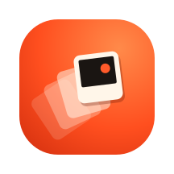
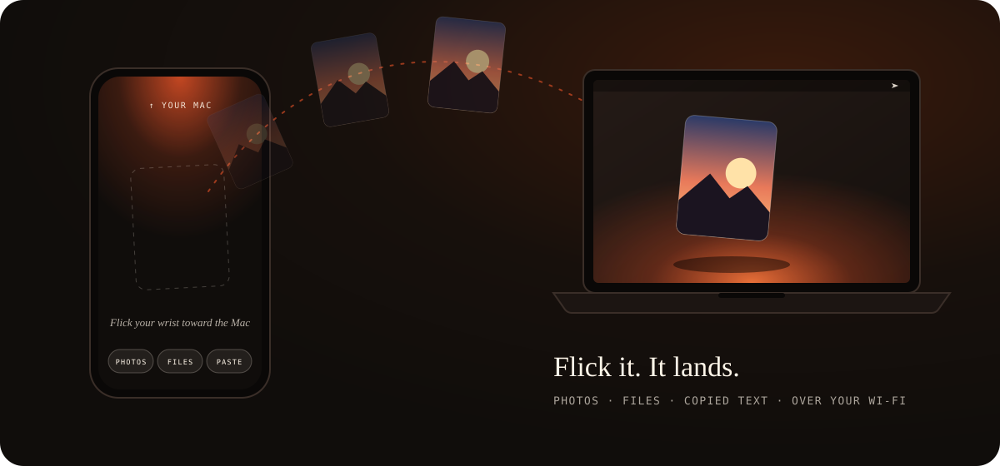
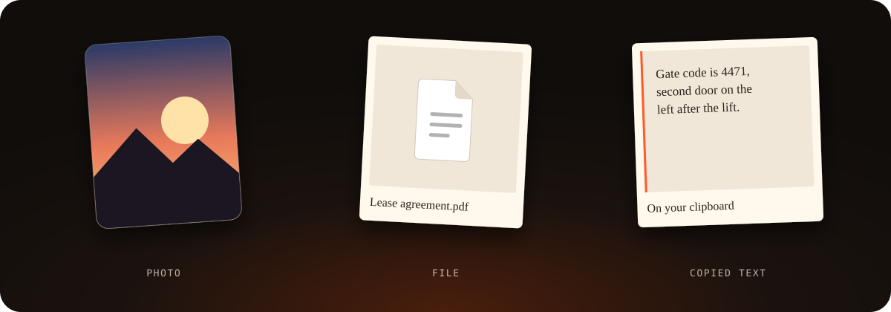
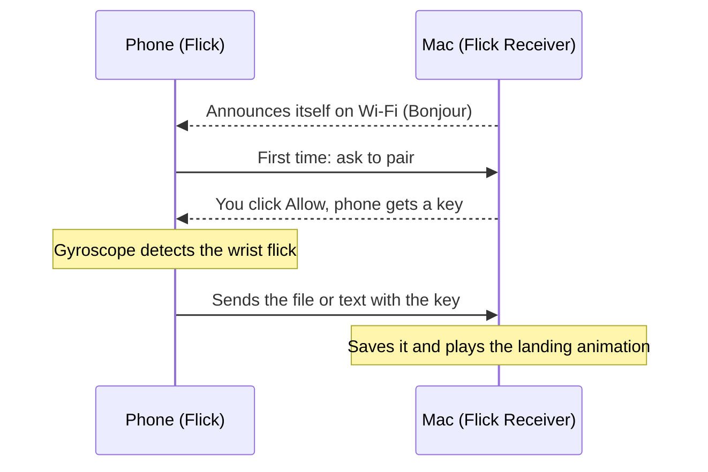

<p align="center">
  
</p>

<h1 align="center">Flick</h1>

<p align="center">
  <b>Flick your Android phone toward your Mac. The photo lands on the screen.</b>
</p>

<p align="center">
  
</p>

<p align="center">
  
  
  
  
  
</p>

---

Hold your phone, snap your wrist toward the Mac, and whatever is on the card flies up onto the Mac's screen. Photos and files are saved to Downloads. Copied text goes straight to the Mac's clipboard.

No account, no cloud, no cable. The two devices talk directly over your Wi‑Fi.

## What you can flick

| On the phone | What happens on the Mac |
| --- | --- |
| A photo or video | Flies onto the screen as a card and is saved to Downloads |
| Several photos at once | Each one lands and is saved |
| Any file | Lands as a paper card with its icon and name |
| Text you copied | Lands in the clipboard, ready to paste |

<p align="center">
  
</p>

Click a card on the Mac to show the file in Finder, or drag the card wherever you want it.

<sub>The pictures on this page are illustrations of the app, not screenshots.</sub>

## How to use it

1. **Open Flick Receiver on the Mac.** A paper-plane icon appears in the menu bar.
2. **Open Flick on the phone.** The top of the screen shows your Mac's name once it is found.
3. **Load something.** Tap **Photos** or **Files**, share into Flick from any app, or copy some text before opening Flick.
4. **Flick your wrist toward the Mac.** You can also swipe the card up.
5. **Click Allow on the Mac** the first time. After that, sends go straight through.

> **Tip:** Tap the status line at the top of the phone app to change flick sensitivity or type in the Mac's address by hand.

## How it works



- **Finding the Mac:** the receiver advertises a Bonjour service named `_flickdrop._tcp`, and the phone looks for it.
- **Detecting the flick:** the phone watches the gyroscope for a fast rotation of the wrist. A harder flick makes the card land higher on the Mac's screen.
- **Pairing:** the first send shows an Allow dialog on the Mac. The phone then keeps a key, and the Mac rejects anything sent without one.

## Install

You build both apps yourself. Nothing is published to an app store.

### Mac receiver

Needs the Swift command-line tools (`xcode-select --install`). Xcode is not required.

```sh
cd mac
./build.sh
open "build/Flick Receiver.app"
```

### Android app

Needs Gradle and the Android SDK with platform 36.

```sh
cd android
echo "sdk.dir=/path/to/your/android/sdk" > local.properties
gradle assembleDebug
adb install -r app/build/outputs/apk/debug/app-debug.apk
```

## Troubleshooting

| Problem | Fix |
| --- | --- |
| Phone says "Looking for your Mac…" | Check both devices are on the same Wi‑Fi and Flick Receiver is running. If it still can't find it, tap the status line, choose **Enter Mac address**, and type the address shown in the Flick menu on the Mac. |
| The flick doesn't trigger | Tap the status line, choose **Flick sensitivity**, and pick **Gentle flick**. Swiping the card up always works. |
| It triggers by accident | Set sensitivity to **Firm flick**. |
| "Click Allow on your Mac" never finishes | Look for the Allow dialog on the Mac; it can open behind other windows. |
| The Mac stopped accepting sends | The phone was forgotten on the Mac. Send again and click Allow. |

## Good to know

- **Same Wi‑Fi only.** There is no relay, so the phone and Mac must be on the same network. Guest, hotel and campus networks often block devices from seeing each other.
- **Not encrypted.** Transfers use plain HTTP on the local network. Use it on networks you trust.
- **Clipboard needs the app open.** Android only lets an app read the clipboard while it is on screen, so open Flick after copying.
- **Quick Share fallback.** If no receiver is found, a flick opens the system share sheet so you can send another way.
- **The receiver doesn't start at login.** Open it again after restarting the Mac.

## Project layout

```
android/   Phone app (Kotlin, no third-party libraries)
  FlickDetector.kt   Wrist-flick detection from the gyroscope
  Transport.kt       Finding the Mac, pairing and uploading
  MainActivity.kt    The screen, pickers, clipboard and card

mac/       Menu bar receiver (Swift, AppKit)
  Server.swift       Bonjour advertising, pairing and receiving
  Cards.swift        The landing card and light bloom
  main.swift         Menu bar item and settings
```
